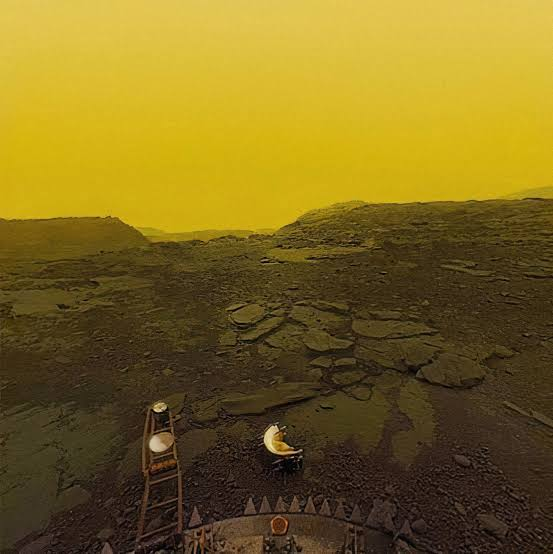

# Plan de mejoras: vuelo de la nave + planetas procedurales

## Decisiones tomadas
- **Vuelo muy arcade** (tipo Freelancer/No Man's Sky): giros rápidos y con respuesta, sin deriva lateral, alabeo automático y cámara con resorte. El Flight Assist apagado (A2) queda fuera; el empuje mantiene algo de rampa para que haya "peso".
- **Se empieza por la fase 1 (vuelo).** Fases 1 y 2 terminadas y en `main`. **Fase 3 terminada** en la rama `fase3-terreno` (pendiente de merge).
- **Cada fase se hace en una sesión nueva** (para no acumular contexto).
- **Planetas realistas fieles**: geografía y colores parecidos a los reales, generados proceduralmente.
- **Extras incluidos**: sonido procedural, gamepad, aterrizaje (va en la fase 5, una vez que haya terreno real). Sin migrar a Vite: se siguen usando módulos ES y `serve.py`.

## Diagnóstico del estado actual

**Nave (`src/ship.js`)**
- El mouse se aplica directo como rotación: `angVel.lerp(inp, dt*18)` alcanza el valor casi en un cuadro, así que no hay inercia de giro.
- La velocidad hace `lerp` hacia la deseada (`dt*3`). Se siente como "teletransporte suave", sin masa ni empuje.
- La cámara está pegada a la nave (`cameraOffset` × `ship.quat`), sin retraso ni balanceo, así que la nave parece congelada en pantalla.
- No hay ningún indicio visual de velocidad: en el espacio vacío no hay referencias, y los 30 m/s y los 3000 km/s se ven iguales.
- No hay banking (alabeo al girar), ni RCS, ni bloom, ni sonido.

**Planetas (`src/textures.js`, `src/system.js`)**
- Una esfera con una textura equirectangular de 512–1024 px generada en la CPU. De cerca se ve borrosa, y la superficie es lisa (no hay relieve).
- La atmósfera es un borde aditivo (rim) en una cáscara de 1.03 R. No hay scattering, no hay cielo desde adentro, no hay atardeceres.
- La colisión es contra una esfera perfecta (`b.R + 15`).

---

## PARTE A: vuelo que se sienta como un juego

### A1. Modelo de giro con inercia (el cambio más importante)
- **Joystick virtual con el mouse**: el desplazamiento del cursor respecto del centro (con zona muerta y curva exponencial) define la *velocidad angular objetivo*. Así se puede girar sostenido sin arrastrar el mouse sin fin. Se dibuja un retículo y un indicador del cursor en el HUD.
- **Resorte-amortiguador por eje** (críticamente amortiguado), con rates distintos para cabeceo, guiñada y alabeo: la nave "agarra" y "suelta" el giro con peso.
- **Alabeo automático al guiñar** (giro coordinado) y **auto-nivelación** opcional respecto del horizonte local cuando estás cerca de un planeta.

### A2. Modelo lineal con masa
- Empuje = aceleración (con límite), no `lerp` de velocidad. Hay momento.
- **Flight Assist (tecla Z)**. Encendido: amortigua gradualmente la deriva lateral (vuelo cómodo). Apagado: newtoniano puro, para derrapar.
- **Boost** con rampa de subida y bajada, más un *kick* de FOV.
- **Supercrucero con carga**: 1,5 s de "spool-up" con vibración y sonido, después entra. La `vmax` en función de la altitud se mantiene, pero se suaviza exponencialmente para que no dé saltos al cambiar de cuerpo.

### A3. Cámara viva
- Cámara de persecución con **resorte**: la posición se retrasa un poco y la rotación hace slerp con lag. Al girar se ve la nave inclinarse en pantalla.
- **Look-ahead**: la cámara se corre hacia el lado del giro.
- **FOV dinámico** según velocidad/aceleración; **shake** leve con boost, carga de supercrucero y entrada atmosférica.
- **Vista libre** (mantener Alt o el botón derecho) para orbitar alrededor de la nave.
- Cabina: balanceo leve de la cabeza por fuerza G.

### A4. Feedback visual y sonoro de velocidad
- **Polvo espacial**: partículas cerca de la cámara que se estiran en líneas según la velocidad. Es *la* clave para sentir movimiento en el vacío.
- Estelas de warp en supercrucero (shader radial).
- Capa cosmética separada de la física: el modelo se inclina un poco extra según el input.
- Propulsores RCS (soplidos al girar y al hacer strafe), llama con ruido, **bloom** en motores y Sol.
- Sonido procedural con WebAudio: zumbido del motor con pitch según el empuje, carga del supercrucero, viento en la atmósfera.
- Soporte de **gamepad** (Gamepad API).

---

## PARTE B: planetas procedurales con superficie y atmósfera

### B1. Terreno real con LOD (cubo-esfera + quadtree)
- Cada planeta rocoso pasa a ser un **cubo proyectado a esfera** con 6 quadtrees. Cada nodo es un *chunk* de 33×33 vértices que se subdivide al acercarse (criterio: error en pantalla).
- Los chunks se generan en **Web Workers** (alturas + normales), con presupuesto de N chunks por cuadro y caché LRU.
- **Precisión**: cada chunk guarda su centro en doubles y sus vértices relativos a ese centro (float32). Se integra con el esquema "cámara en el origen" que ya existe.
- Cosido de bordes entre niveles con faldones (*skirts*).
- **Colisión y altitud reales**: la misma función de altura se evalúa en la CPU para la nave (aterrizar, volar rasante). El supercrucero usa la altitud sobre el terreno.

### B2. Recetas de terreno por planeta (deterministas por semilla)
Funciones combinables: fbm, ridged multifractal (cordilleras), domain warping, cráteres (Voronoi con borde y pico central, en varias escalas), dunas, terrazas, grietas.

| Cuerpo | Receta |
|---|---|
| Tierra | Continentes + cordilleras ridged + océano (nivel del mar), amplitud ~9 km |
| Marte | Llanuras + Olympus Mons (22 km) + un cañón tipo Valles Marineris + cráteres + casquetes |
| Luna / Mercurio | Cráteres en 4 escalas + maria (cuencas lisas y oscuras) |
| Venus | Mesetas volcánicas suaves (bajo nubes opacas) |
| Ío | Calderas volcánicas + lagos de lava emisivos |
| Europa | Hielo liso + grietas lineales (ridged de banda angosta) |
| Calisto / Ganimedes / Rea | Saturación de cráteres / terreno estriado |
| Titán | Dunas + lagos de metano |
| Fobos / Deimos | Asteroide deformado (no esférico) + cráteres |

### B3. Shading de superficie
- Shader propio: el **bioma** sale de altura, latitud, pendiente y humedad (roca en pendientes, nieve en cumbres y polos, arena, vegetación).
- **Detalle multiescala** con ruido en el fragment shader (triplanar), así se ve nítido a 100 m de altura.
- Normales a partir de las derivadas del ruido.
- **Océano** (Tierra, Titán): olas de ruido animadas, reflejo especular del Sol (glint), Fresnel, color según profundidad.
- Lado nocturno de la Tierra: luces de ciudades procedurales en zonas costeras y templadas.
- Ío: lava emisiva. Europa: hielo con especular.

### B4. Atmósfera física (scattering)
- Pasada de **post-proceso a pantalla completa** con raymarching de **Rayleigh + Mie** (single scattering, con absorción de ozono para la Tierra). Usa el depth buffer (hay que reconstruir la profundidad del depth logarítmico).
- Parámetros por planeta en `bodies.js`: radio de la atmósfera, coeficientes β de Rayleigh/Mie, escala de altura, color de absorción.
  - Tierra: cielo azul, atardeceres naranjas.
  - Marte: cielo caramelo con **atardeceres azules**.
  - Venus: opaca, amarilla y densa.
  - Titán: neblina naranja espesa.
- **Perspectiva aérea**: las montañas lejanas se azulan.
- Desde adentro, el cielo se ilumina y las estrellas se desvanecen según la luminancia del cielo. La transición espacio → superficie es continua.

### B5. Nubes
- Tierra: cáscara de nubes procedural animada (domain warping que fluye) con **sombras de nubes** sobre el terreno.
- Más adelante, nubes volumétricas por raymarching cerca de la superficie (es caro, va con preset de calidad).

### B6. Gigantes gaseosos y anillos
- Shader animado en GPU (no textura fija): bandas con **flujo diferencial por latitud**, turbulencia por domain warping, tormentas y vórtices (Gran Mancha Roja, Mancha Oscura).
- Descenso a la atmósfera: niebla que se espesa, oscurecimiento y un "piso" de presión que impide seguir bajando.
- Anillos: iluminación según el ángulo del Sol, **sombra del planeta sobre los anillos y de los anillos sobre el planeta**, y partículas de hielo al cruzarlos.

### B7. Post-proceso y calidad
- Pipeline HDR: bloom, lens flare del Sol, eclipses (sombra de la Luna sobre la Tierra).
- Presets de calidad (Bajo / Medio / Alto / Ultra): resolución de chunks, pasos de raymarch, nubes volumétricas.
- Medidor de FPS en el HUD (F3).

---

### B8. Descensos cinematográficos (pedido del usuario)
Bajar a cada planeta tiene que ser **impactante**: cruzar capas, cambiar la luz y descubrir una superficie distinta en cada mundo. Se apoya en B1–B5 (terreno, shading, atmósfera desde adentro, nubes).

| Cuerpo | Experiencia de descenso |
|---|---|
| Venus | Atravesar un mar de **nubes amarillas volumétricas** (~45–70 km) con turbulencia y temblor de cámara. Debajo, luz naranja apagada y bruma densa; llanuras basálticas con **ríos y lagos de lava** que brillan (emisivo + bloom), volcanes (Maat Mons), calor que distorsiona el aire. *Nota: hoy Venus no tiene ríos de lava activos confirmados; se dramatiza como vulcanismo activo.* |
| Tierra | Capa de nubes volumétricas, océano con reflejo del Sol, montañas nevadas, luces de ciudades de noche. |
| Marte | Cielo caramelo, **tormentas de polvo** que bajan la visibilidad, Valles Marineris y Olympus Mons a escala, remolinos de polvo, atardecer azul. |
| Titán | Neblina naranja espesa, **lagos de metano** espejados, dunas, llovizna de metano. |
| Júpiter / Saturno | Hundirse entre bandas de nubes de colores, **relámpagos** en las tormentas, oscuridad y presión creciente hasta el límite. Cruzar los anillos de Saturno entre bloques de hielo. |
| Ío | **Plumas volcánicas** de cientos de km, lagos de lava (Loki Patera), azufre amarillo. |
| Europa / Encélado | Hielo agrietado, **géiseres** de vapor (Encélado), Júpiter gigante en el cielo. |
| Luna / Mercurio | Cráteres nítidos, sombras duras, la Tierra o el Sol enormes en el horizonte. |

Técnica: nubes volumétricas por raymarching (B5), emisivos con bloom (lava), partículas (plumas, polvo, lluvia, hielo), niebla de altura y sonido de viento según la densidad del aire.

### B9. Fidelidad real por capas (pedido del usuario)
No hacen falta millones de texturas ni objetos. Se arman **tres capas**, de lo más grueso a lo más fino:

1. **Base real a baja resolución:** mapas de altura y color globales reales y livianos (unos pocos MB por cuerpo), de dominio público:
   - Marte: MOLA.
   - Luna: LOLA.
   - Tierra: ETOPO/GEBCO + Blue Marble.
   - Mercurio: MESSENGER.
   - Lunas galileanas y Titán: mosaicos de Galileo/Cassini.

   Con esto los continentes, cuencas, maria y casquetes quedan **en su lugar real**. Reemplaza a las texturas inventadas.
2. **Detalle procedural encima:** el ruido, los cráteres chicos, las rocas y la erosión de las recetas de B2 se suman a la base real y solo agregan escala fina. No mueven nada de lugar.
3. **Puntos icónicos hechos a mano en 3D:** modelados o con una receta especial de alta calidad, ubicados en sus coordenadas reales:
   - Marte: Olympus Mons, Valles Marineris, Gale y Jezero.
   - Luna: Tycho, Copérnico, el Mar de la Tranquilidad con el sitio del Apolo 11.
   - Tierra: Everest/Himalaya, Gran Cañón, Andes/Aconcagua, ciudades grandes con luces.
   - Venus: Maat Mons, con lava en la versión dramatizada de B8.
   - Ío: Loki Patera. Europa: líneas de Conamara.
   - Júpiter: Gran Mancha Roja (vórtice animado). Saturno: hexágono polar. Neptuno: Gran Mancha Oscura.

   Cada punto icónico es un "parche" que reemplaza la altura y el color en su zona y tiene su propio nivel de detalle.

Datos y licencias: antes de bajar cualquier dataset se pide permiso con fuente, licencia y tamaño. Se guardan en `assets/planets/<id>/`.

## PARTE C: navegación

### C1. Mapa holográfico 3D (pedido del usuario)
- **Mapa del sistema (tecla a definir):** maqueta holográfica 3D del sistema solar (líneas y puntos con glow cian, escala logarítmica de distancias). Se puede rotar y hacer zoom con el mouse, elegir un objetivo con clic y trazar la ruta con el tiempo estimado en crucero. Muestra la posición de la nave y las órbitas.
- **Minimapa en el HUD:** radar holográfico en una esquina con los cuerpos cercanos, el objetivo, el vector de velocidad y la altura relativa (estilo radar 3D de los juegos espaciales).
- **Mapa planetario:** al acercarte a un planeta, globo holográfico con los puntos icónicos de B9, la posición de la nave, el terminador día/noche y marcadores para ir a un lugar ("ir a Olympus Mons").
- Estética coherente con el HUD (`hud-indicadores`): scanlines suaves, parpadeo al abrir, sonido de interfaz.

## PARTE D: visión y sensores (para mundos oscuros)
| Modo | Qué hace | Dato real |
|---|---|---|
| **Faros y bengalas** | Focos delanteros y luces de aterrizaje con haz visible en la niebla y las nubes; bengalas lanzables que iluminan una zona un rato. | — |
| **Visión nocturna** | Amplifica la poca luz que haya; tono verde con grano. | — |
| **Térmica / infrarroja** | Cada píxel según su temperatura (paletas blanco-caliente, hierro, arcoíris). La temperatura sale del modelo físico del HUD (`physics/environment`): día/noche, latitud, altura, lava, topes de nubes fríos. | Bajo las nubes de Venus el suelo está a 464 °C y brilla en infrarrojo; así lo fotografiaron Venus Express y Akatsuki. |
| **Radar / LIDAR** | Pulso que barre el terreno y lo revela en malla topográfica, aunque haya nubes opacas. | Así mapeó Venus la sonda Magellan. |

Se cambia con una tecla de modo, con indicador en el HUD y sonido. Técnica: modo en el shader del terreno + pase de post-proceso.

## PARTE E: etiquetas de lugares
- Base de datos con **coordenadas reales** (nomenclátor planetario de la IAU/USGS, dominio público), empezando por:
  - Tierra: continentes, océanos, ciudades, montañas.
  - Luna: mares, cráteres, sitios del Apolo.
  - Marte: Olympus Mons, Valles Marineris, Hellas, Gale (Curiosity), Jezero (Perseverance).
- Aparecen por nivel de detalle (de lejos continentes y mares, de cerca cráteres y ciudades), se ocultan tras el horizonte y se desvanecen suave. Clic → "ir a".
- **Depende de B9**: sin geografía real las etiquetas caerían sobre continentes inventados.

## PARTE F: mucho más detalle (prioridad Tierra, Luna, Marte)
- **Geografía:** base real (B9) + mosaicos de más resolución alrededor de lugares famosos + detalle procedural.
- **3D:** rocas por instancias, vegetación por bioma en la Tierra, ciudades procedurales en coordenadas reales con luces nocturnas, nieve, ríos.
- **Visual:** sombras del terreno y la nave, océano con olas/espuma/reflejos, relieve fino, perspectiva aérea, auroras (Tierra, Júpiter).
- **Atmósfera desde adentro:** cielo completo, atardeceres; clima: lluvia, nieve, niebla, tormentas de polvo en Marte, relámpagos.
- **Sonido ambiente:** viento según densidad (Marte fino y apagado, como en las grabaciones de Perseverance), truenos, lluvia, oleaje, silencio en la Luna, Doppler de la nave, sonidos de interfaz.
- **Música (más adelante):** sistema adaptativo por capas (exploración, aproximación, descenso); dejar ganchos desde ahora (bus de audio, ducking).

## PARTE G: cabina y aterrizaje
- **Vista de cabina real:** interior 3D de la cabina con su propio FOV (más abierto, ~80–90°, y ajustable), marco del vidrio, reflejos sutiles en el cristal, polvo o gotas al atravesar nubes y lluvia.
- **Controles en 3D:** palanca y acelerador que se mueven con tu input, pantallas MFD con el HUD (radar, mapa, sensores, motores), luces de alerta reales en el tablero.
- **Sensación de estar adentro:** la cabeza se balancea con las fuerzas G, vibración por motor y turbulencia, mirada libre con el mouse (botón derecho), sonido amortiguado del exterior según la densidad del aire, respiración y crujidos del casco en la reentrada.
- **Aterrizaje automático:** cerca de la superficie (en modo atmosférico o sobre cuerpos sin aire), una tecla busca un lugar plano cerca (por la pendiente del terreno), baja con desaceleración suave, despliega el tren de aterrizaje y apoya la nave alineada con el suelo. Otra tecla despega. Con indicador en el HUD (altura, velocidad vertical, inclinación del terreno) y aviso si el lugar es demasiado empinado.

## Referencias visuales por planeta

### Venus: superficie (referencia del usuario)

Así tiene que verse Venus debajo de las nubes. La imagen está basada en las panorámicas de las sondas Venera 13/14 coloreadas.
- **Cielo:** amarillo-naranja parejo y opaco, sin Sol visible. Toda la luz es difusa y llega desde arriba, filtrada por las nubes (nada de cielo azul ni de disco solar).
- **Luz:** muy pareja, casi sin sombras marcadas, bajo contraste. Todo queda teñido de amarillo-ocre, como al atardecer pero sin dirección.
- **Bruma:** densa. La visibilidad cae en pocos km y el horizonte se funde con el cielo en el mismo tono amarillo. Las colinas lejanas son siluetas lavadas.
- **Suelo:** **losas de basalto planas y fracturadas** en capas (placas que parecen baldosas rotas), con tierra y grava oscura gris-marrón entre ellas. Relieve suave de lomas bajas, nada de picos filosos.
- **Detalle cercano:** piedras sueltas chicas y bordes de placas que asoman. Texturas de roca volcánica porosa.
- **Sensación:** opresiva, caliente y densa (92 bar, 464 °C). Leve distorsión por el calor y sonido grave y apagado.
- **Lava:** la versión dramatizada de B8 (ríos de lava) va en zonas volcánicas puntuales (Maat Mons), no en todo el planeta. La mayor parte se ve como esta referencia.

Técnica: neblina de altura con el color del cielo, luz ambiente fuerte desde arriba + luz del Sol muy atenuada y difusa (sin sombras duras), receta de terreno "losas" (Voronoi plano con bordes fracturados y terrazas), rocas por instancias, y un tone mapping/grading cálido propio para Venus.

### Mercurio: superficie (referencia del usuario)
Imagen de referencia: ilustración de Science Photo Library, con derechos de autor. Está solo en local, en `docs/referencias/privadas/mercurio-superficie.webp`, y no se sube al repo.
- **Cielo:** negro total, porque no hay atmósfera. **Estrellas y la Vía Láctea visibles a pleno día**.
- **Sol:** enorme (unas 2,5–3 veces más grande que visto desde la Tierra) y cegador, con halo, destellos y rayos (bloom fuerte, lens flare). Bajo sobre el horizonte, deja luz rasante.
- **Luz:** dura y direccional, **sombras negras puras con bordes filosos** y contraste extremo: la cara iluminada casi blanca y la cara en sombra casi negra. Solo un rebote muy tenue del suelo.
- **Sin bruma:** lo lejano se ve tan nítido como lo cercano. El horizonte es una línea limpia contra el negro.
- **Suelo:** gris (levemente frío o pardo), regolito con **rocas angulosas picadas** por microimpactos, bloques sueltos, bordes de cráteres grandes y escarpes lobulados (los acantilados típicos de Mercurio) a la distancia.
- **Sensación:** desolada y silenciosa, luz brutal. Sonido: solo la nave, nada del exterior.

Técnica: bloom y flare del Sol escalados con la distancia (Mercurio está a 0,39 UA), sombras proyectadas de alta calidad (es donde más se notan), ambiente casi nulo, estrellas visibles en la superficie (sin atenuar el cielo porque no hay atmósfera), rocas por instancias y receta de terreno con cráteres y escarpes.

### Júpiter: un mundo de nubes y la Gran Mancha Roja (referencia del usuario)
Imagen de referencia: fotograma de la serie *Cosmos* (FOX), con derechos de autor. Está solo en local, en `docs/referencias/privadas/jupiter-nubes.png`.
- **Todo es nube:** no hay suelo. **Paredes de nubes volumétricas gigantes**, muros que suben kilómetros, cúmulos que se hinchan en primer plano y vórtices que se enroscan. Las formas tienen **estrías y líneas de flujo**, como capas de crema batida estiradas por el viento.
- **Colores:** crema, ocre, caramelo y marrón cálido. Más arriba, blancos de amoníaco; más abajo, naranjas y marrones (hidrosulfuro de amonio). Dentro de la Gran Mancha Roja, rojo-naranja intenso.
- **Cielo:** arriba de las nubes altas, casi negro con estrellas (la atmósfera superior es tenue). Al bajar, se cierra en bruma marrón y oscuridad.
- **Luz:** el Sol está lejos (5,2 UA, 1/27 de la luz que llega a la Tierra), así que la luz es más tenue, cálida y de costado, y marca el relieve de las nubes con sombras suaves y largas.
- **Escala:** brutal. Lo que parece una nube cercana mide decenas de km.

**Meterse en la megatormenta (Gran Mancha Roja), con datos reales para que se sienta:**
- Unos 16.000 km de ancho (más grande que la Tierra), anticiclón del hemisferio sur que gira en sentido antihorario en ~6 días, con vientos de ~430–680 km/h en el borde. Sube unos 8 km sobre las nubes de alrededor y tiene raíces de cientos de km (misión Juno).
- **Experiencia:**
  - Desde lejos, un ojo rojo que gira de verdad, animado.
  - Al acercarte, muros en espiral que te rodean y el viento te arrastra en la dirección del giro (fuerza lateral sobre la nave).
  - Turbulencia y vibración que crecen hacia el borde.
  - **Relámpagos** en las capas profundas de agua, que iluminan las nubes desde adentro.
  - Rugido del viento grave y continuo.
  - Al bajar, todo se oscurece, sube la presión y el casco se calienta, hasta un límite donde el HUD obliga a salir.
- Los **sensores** (parte D) sirven acá: la térmica muestra las capas calientes profundas y el radar los muros de la tormenta en la oscuridad.

Técnica: nubes volumétricas en varias capas (amoníaco, NH₄SH, agua) con flujo animado por bandas y un vórtice paramétrico para la Gran Mancha Roja (campo de velocidad que deforma el ruido), relámpagos como luces puntuales breves dentro del volumen, niebla y oscurecimiento por profundidad, viento como fuerza sobre la nave en modo atmosférico, sonido de viento y truenos.

### Saturno: viajar por los anillos (referencia del usuario)
Dos imágenes de referencia, de arte digital sin fuente conocida. Están solo en local, en `docs/referencias/privadas/saturno-anillos-1.png` y `-2.png`.
- **Decisión: mezcla.** El hielo real es la base (blanco-crema con tinte rosado o pardo), con los **tonos cálidos, las estrías y la densidad de rocas de las referencias** para que impacte.
- **De lejos:** bandas concéntricas finísimas, como los surcos de un disco, con franjas más claras y más oscuras (anillos C, B, A, división de Cassini, Encke). Brillo cálido del lado iluminado, y Saturno enorme con sus bandas crema y ocre.
- **Rasante sobre el plano del anillo** (segunda referencia): una "ruta" infinita de partículas que se pierde en una curva hacia el horizonte. **Estrías por velocidad** (motion blur radial) y bloques de hielo y roca de todos los tamaños que pasan cerca, **arrojando sombras largas** sobre el polvo del anillo. El Sol bajo, chico y brillante, con el planeta llenando medio cielo.
- **Adentro del anillo:**
  - El anillo es finísimo (~10 m a 1 km de espesor) pero enorme. Al cruzarlo, una nube de partículas te rodea por un instante: golpes de hielo contra el casco, chispas, temblor.
  - Volando dentro, campo de bloques flotantes para esquivar: piezas de cm hasta casas (~10 m), con alguno más grande ocasional.
- **Detalles reales:**
  - Sombra de Saturno proyectada sobre los anillos.
  - Sombra de los anillos sobre el planeta.
  - "Rayos" (spokes) oscuros que aparecen y desaparecen.
  - Las lunas pastoras (Prometeo, Pandora) cerca del anillo F.

Técnica: textura radial de alta resolución (ya existe una base en `ringTexture`) más **instancias de partículas en la vecindad de la cámara** (campo procedural determinista por celda, como el polvo espacial pero con rocas 3D, generadas y recicladas alrededor de la nave), sombras de rocas sobre el plano, motion blur por velocidad, iluminación de dispersión hacia adelante (los anillos brillan a contraluz), y sonido de impactos de hielo al cruzar.

## Fases sugeridas (cada una deja el juego funcionando)

1. **Vuelo** (A1–A4 sin sonido): impacto inmediato, bajo riesgo.
2. **Post-proceso + atmósfera por scattering vista desde el espacio** (B4 parcial, B7 bloom): el salto visual más grande por el esfuerzo.
3. ✅ **Terreno LOD + colisión real** (B1, base de B2) — hecho: ver "Estado de la fase 3" abajo.
4. **Recetas por planeta + shading de superficie + océano** (B2, B3).
5. **Atmósfera desde adentro, nubes, aterrizaje y descensos cinematográficos** (B4 completo, B5, B8): Venus primero.
6. **Gigantes gaseosos animados, anillos con sombras, descensos a Júpiter/Saturno, plumas de Ío, pulido** (B6, B8).
7. **Fidelidad real por capas y puntos icónicos** (B9): primero Marte y la Luna (MOLA/LOLA + Olympus Mons, Valles Marineris, Tycho).
8. **Mapa holográfico 3D, minimapa y mapa planetario** (C1).

### Orden acordado para lo que sigue (una sesión por vez, en Sonnet)
1. **Sensores** (D): faros y bengalas, visión nocturna, térmica, radar/LIDAR.
2. **Cabina y aterrizaje automático** (G).
3. **Mapas reales** de la Tierra, la Luna y Marte (B9), pidiendo permiso antes de bajar datos.
4. **Etiquetas de lugares** (E).
5. **Detalle 3D y visual** (F): Tierra, Luna, Marte.
6. **Clima y sonido ambiente** (F).
7. **Mapa holográfico** (C1) y, al final, **música**.

## Cambios técnicos de base
- Tal vez convenga pasar a **Vite** (dev server + bundling de workers y GLSL en archivos `.glsl`). Si no, se pueden seguir usando módulos ES nativos con workers `type: "module"`.
- Nuevos módulos: `flight.js` (física de vuelo), `camera.js` (cámara de persecución), `fx/` (polvo, warp, post), `planet/` (quadtree, chunk worker, recetas, shaders), `atmosphere/`.

## Estado de la fase 3 (terreno LOD) — hecha
Diseño final (todo en `src/planet/`, sin THREE salvo `terrain.js`):
- `noise.js` (ruido de valor + Perlin + fbm/ridged con rango de octavas), `styles.js` (colores por cuerpo, compartido con `textures.js`), `faces.js` (cubo esferizado), `recipes.js`, `chunkWorker.js`, `terrain.js`.
- **Recetas** `getRecipe(id, R)` → `{ heightAt(sx,sy,sz,minWl), minH, maxH, emissive() }`. Las usan el worker y el hilo principal (colisión/altitud), así coinciden. La dirección va en "espacio de estilo" (`styleDir`: (-dx, dy, dz)) para que el relieve coincida con la textura. Luna, Tierra, Marte, Mercurio y receta genérica para las demás lunas (`GENERIC`). Venus, Titán, gigantes y Sol: sin terreno.
- **Chunks** de 33×33 + faldones + anillo extra para normales (sin grietas), vértices en float32 relativos al centro; cada malla se ubica con `b.rel + qBody·centro` en doubles. Pool de 3–6 workers.
- **Quadtree**: se divide si distancia < 4 × lado; hijos sólo cuando los 4 están listos; culling por horizonte (radio ocultador adaptativo) y frustum; poda por antigüedad; cola por nivel y distancia. Se enciende a < 6R y apaga a > 7R.
- **Colisión**: `system.surfaceRadius`, `nearestSurface` y `ship.js` (10 m de margen); la cámara de persecución no entra al suelo. **Co-rotación** de la nave < 3R (`ship.coRotate`).
- Material con `onBeforeCompile`: textura del cuerpo por UV equirectangular sin costura (Tarini + `textureGrad`), × sombreado por pendiente/ruido, canal emisivo para lava.

Medido (1280×720, panel del navegador): ~3.5 ms/cuadro a 50 m de la Luna con ~680 chunks / 1.6 M tris; ~4.8 ms con 987 chunks / 2.3 M tris dentro de un cráter profundo. Un chunk tarda 4–12 ms en el worker. Co-rotación a ×1000: 0° de deslizamiento (8,2° sin ella). Choque a 108 km/s: nunca bajó de 10 m.

**Queda para la fase 4:** shading por bioma (altura/latitud/pendiente/humedad) y detalle triplanar en el fragment shader; océano real (hoy plano a 0 m, con el color de la textura); las nubes de la textura de la Tierra aparecen pintadas en el suelo (hay que sacarlas de la textura del terreno y hacerlas capa propia); recetas específicas (Olympus Mons, Valles Marineris, calderas y lava emisiva de Ío, grietas de Europa, Fobos/Deimos no esféricos); relieve de Venus/Titán (fase 5). Ajustes posibles: `K_SPLIT`, tamaño del pool, límites de caché en `terrain.js`.

## HUD de instrumentos
- Tecla I: sci-fi / aviónica / minimalista (se guarda en localStorage).
- `src/physics/` (datos y atmósferas por cuerpo), `src/hud/` (telemetría, instrumentos en canvas, alertas).
- La velocidad respecto del aire (Mach, q, calentamiento) descuenta la rotación del planeta; la altitud sale de `ship.nearest.alt`, así que acompañará al terreno real cuando se integre.

---

## Estado: nubes volumétricas y look cinematográfico (rama `claude/nubes-volumetricas-a8290c`)

Módulos nuevos (el resto de los archivos sólo tiene ganchos chicos en `main.js` y `textures.js`):
- `src/clouds/clouds.js`: `CloudPass`, pasada del composer con raymarch + temporal + composición. `CLOUD_COMMON` exporta `cloudShadow(P)` (sombra 2D de las nubes en un punto, en km del marco local del planeta): **gancho para el shader del terreno**, sólo hay que incluir el GLSL y llamarla.
- `src/clouds/profiles.js`: capa por planeta (Tierra 1–12 km, Venus 45–70 km, Marte, Titán).
- `src/clouds/noise.js`: ruido Perlin-Worley 128³ y Worley 32³ horneados en GPU (~1,3 s al arrancar) y mapa de cobertura de la Tierra (mismo patrón que antes estaba pintado en la textura; ya no se pinta).
- `src/post/cinematic.js`: god rays + lens flare (HDR, antes del bloom, visibilidad del Sol analítica contra las esferas) y curva de color + viñeta + grano (después del OutputPass).
- `src/post/quality.js`: presets Bajo/Medio/Alto/Ultra, FPS y tiempos de GPU por pasada.
- `tools/debug_nubes.js`: ayudante para probar con el panel oculto (`await import('/tools/debug_nubes.js')`).

Técnica: raymarch a resolución reducida con profundidad **logarítmica** reconstruida del depth (`RenderTarget.depthTexture`), todo en km en el marco local del planeta (sin coordenadas gigantes), luz hacia el Sol con pasos exponenciales, Beer + powder, doble lóbulo Henyey-Greenstein (silver lining), 3 octavas de dispersión múltiple aproximada (en Venus lo profundo se vuelve naranja), ambiente del cielo, perspectiva aérea con el mismo modelo de `atmosphere.js`, reproyección temporal con clamp de vecindario y upsample bilateral contra la profundidad real (la nave y el relieve ocluyen y son ocluidos; no se asume suelo esférico). Debajo de la capa de Venus hay sombra/adaptación del ojo.

Teclas nuevas: **F3** FPS y tiempos por pasada · **F4** (Shift+F4) preset de calidad · **K** look cinematográfico · **Z** nubes (era U; chocaba con el modo impulso).

Costo medido (RTX 3060 Ti, ~3,8 M px ≈ 1440p, preset Alto, ms por cuadro con sincronización):

| Escena | total | nubes | cine | bloom |
|---|---|---|---|---|
| Tierra desde 16.000 km | 4,5 | ~1,1 | ~1,4 | ~0,9 |
| Cúmulos a 6 km | 7,1 | ~2,3 | ~2,3 | ~0,5 |
| Venus sobre la capa | 6,7 | ~2,1 | ~2,1 | ~0,1 |
| Dentro de la capa de Venus | 8,2 | ~3,6 | ~2,2 | ~0,4 |
| Debajo de la capa | 6,6 | ~2,0 | ~2,0 | ~0,4 |

Ultra sube las nubes a ~5–9,5 ms; Bajo las deja en ~1–1,3 ms. Todo cabe en 60 fps con Alto.

Pendiente / ideas: sombra de nubes sobre el terreno (enganchar `cloudShadow`), relámpagos en la capa de Venus, tormentas de polvo de Marte, lluvia en Titán, nubes en los gigantes gaseosos, nubes distantes de la Luna hacia el planeta compuestas con anillos de Saturno.
